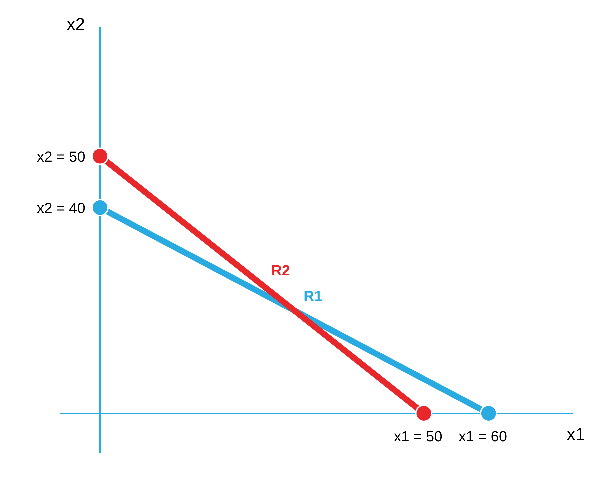
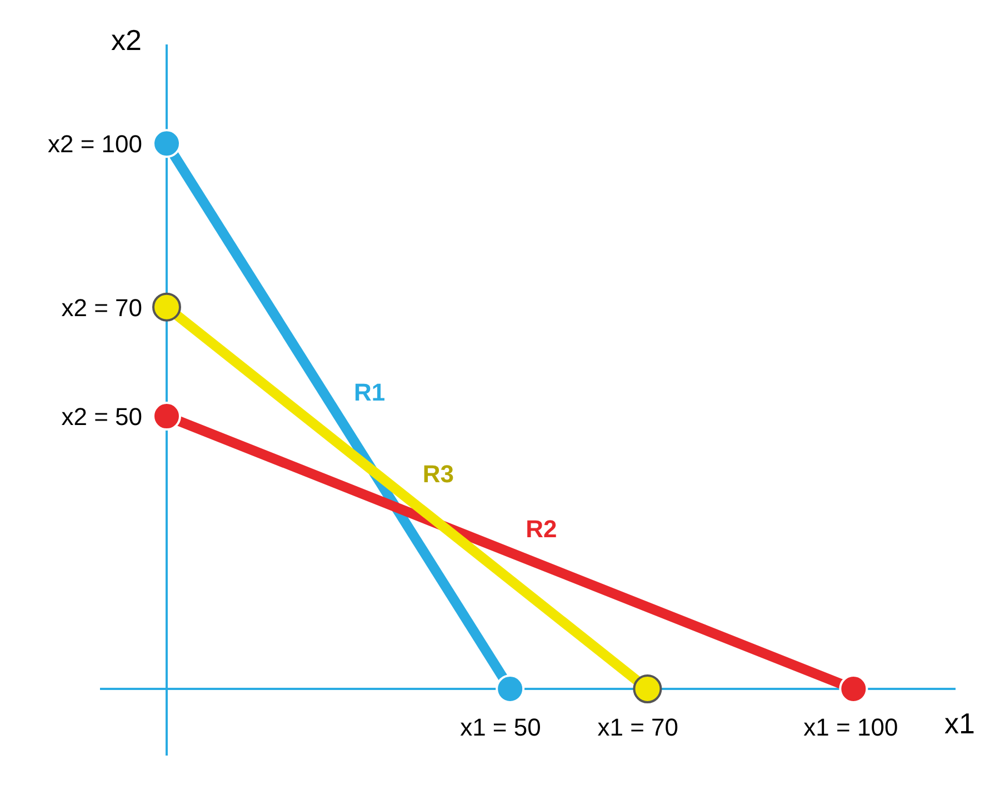
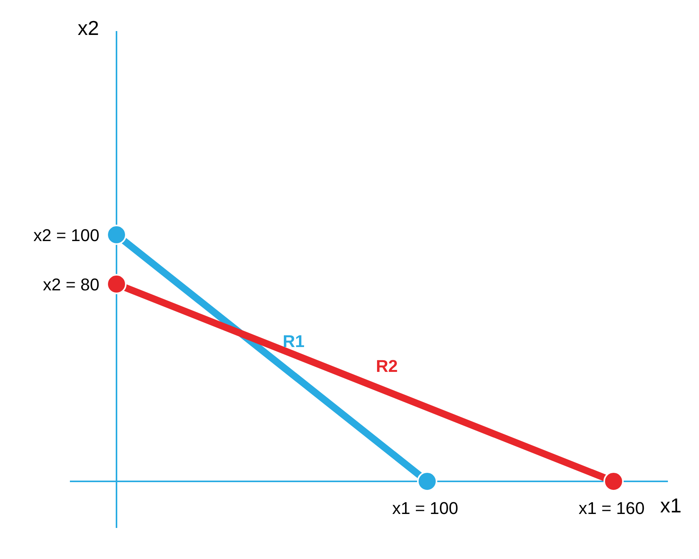

# Método gráfico con FIBO

Tres ejercicios con la barra FIBO, resueltos con el mismo procedimiento de la Clase 02
(Introducción al Método Gráfico): Paso 1 a Paso 4. Los números son ilustrativos.

Nota: los valores "x1" se representan en el eje X (horizontal) y los valores "x2" en el eje Y (vertical).
Condición de no negatividad: x1 ≥ 0, x2 ≥ 0 (solo primer cuadrante).

---

## Ejercicio 1 (2 restricciones)

El Molino produce dos sabores de FIBO y quiere maximizar su utilidad diaria.
Cada caja de Chocolate deja $120 y cada caja de Cookies deja $150.
Cada caja de Chocolate usa 2 kg de proteína y cada caja de Cookies usa 3 kg; hay 120 kg al día.
Cada caja (de cualquier sabor) usa 1 hora de empacado; hay 50 horas al día.

Variables de decisión:
- x1 = cajas de FIBO Chocolate a producir
- x2 = cajas de FIBO Cookies a producir

```
Maximizar:
    F.O.:   120x1 + 150x2
Sujeto a:
    R1:   2x1 + 3x2 ≤ 120     (proteína)
    R2:   1x1 + 1x2 ≤ 50      (empacado)
```

Paso 1: Crear un sistema de ecuaciones con igualdades
```
R1:  2x1 + 3x2 ≤ 120   →   2x1 + 3x2 = 120
R2:  1x1 + 1x2 ≤ 50    →   1x1 + 1x2 = 50
```

Paso 2: Encontrar valores X1 y X2 en ambas ecuaciones (eliminar X2 para encontrar X1 y viceversa)
```
1)  2x1 = 120
    3x2 = 120

2)  1x1 = 50
    1x2 = 50
```

Paso 3: Despejar ecuación y encontrar valor X1 y X2
```
1)  2x1 = 120 → x1 = 120/2 = 60
    3x2 = 120 → x2 = 120/3 = 40

2)  1x1 = 50  → x1 = 50/1 = 50
    1x2 = 50  → x2 = 50/1 = 50
```

Paso 4: Representar valores en gráfica (plano cartesiano)
- R1 (azul): de x1 = 60 a x2 = 40
- R2 (rojo): de x1 = 50 a x2 = 50



---

## Ejercicio 2 (3 restricciones)

FIBO va a producir lotes de Brownie y Frutos rojos y quiere maximizar su utilidad.
Cada lote de Brownie deja $3 mil y cada lote de Frutos rojos deja $2 mil.
- Proteína: Brownie usa 2 kg y Frutos rojos 1 kg por lote; hay 100 kg.
- Cobertura/relleno: Brownie usa 1 kg y Frutos rojos 2 kg por lote; hay 100 kg.
- Horas de horno: cada lote usa 1 hora; hay 70 horas.

Variables de decisión:
- x1 = lotes de FIBO Brownie a producir
- x2 = lotes de FIBO Frutos rojos a producir

```
Maximizar:
    F.O.:   3x1 + 2x2
Sujeto a:
    R1:   2x1 + 1x2 ≤ 100     (proteína)
    R2:   1x1 + 2x2 ≤ 100     (cobertura/relleno)
    R3:   1x1 + 1x2 ≤ 70      (horas de horno)
```

Paso 1: Crear un sistema de ecuaciones con igualdades
```
R1:  2x1 + 1x2 = 100
R2:  1x1 + 2x2 = 100
R3:  1x1 + 1x2 = 70
```

Paso 2: Encontrar valores X1 y X2 en las ecuaciones (eliminar X2 para encontrar X1 y viceversa)
```
R1:  2x1 = 100
     1x2 = 100

R2:  1x1 = 100
     2x2 = 100

R3:  1x1 = 70
     1x2 = 70
```

Paso 3: Despejar ecuación y encontrar valor X1 y X2
```
R1:  2x1 = 100 → x1 = 100/2 = 50
     1x2 = 100 → x2 = 100/1 = 100

R2:  1x1 = 100 → x1 = 100/1 = 100
     2x2 = 100 → x2 = 100/2 = 50

R3:  1x1 = 70  → x1 = 70/1 = 70
     1x2 = 70  → x2 = 70/1 = 70
```

Paso 4: Representar valores en gráfica (plano cartesiano)
- R1 (azul): de x1 = 50 a x2 = 100
- R2 (rojo): de x1 = 100 a x2 = 50
- R3 (amarillo): de x1 = 70 a x2 = 70



---

## Ejercicio 3 (marketing, 2 restricciones)

FIBO reparte su inversión entre anuncios en TikTok/Instagram y sampling en universidades
y quiere maximizar cuántas personas prueban la barra.
Cada mil pesos en anuncios logra 30 personas; cada mil pesos en sampling logra 50.
- Presupuesto: $100 mil.
- Horas del equipo: cada mil en anuncios requiere 1 hora y cada mil en sampling 2 horas; hay 160 horas.

Variables de decisión:
- x1 = miles de pesos invertidos en anuncios
- x2 = miles de pesos invertidos en sampling

```
Maximizar:
    F.O.:   30x1 + 50x2
Sujeto a:
    R1:   1x1 + 1x2 ≤ 100     (presupuesto)
    R2:   1x1 + 2x2 ≤ 160     (horas del equipo)
```

Paso 1: Crear un sistema de ecuaciones con igualdades
```
R1:  1x1 + 1x2 = 100
R2:  1x1 + 2x2 = 160
```

Paso 2: Encontrar valores X1 y X2 en ambas ecuaciones
```
1)  1x1 = 100
    1x2 = 100

2)  1x1 = 160
    2x2 = 160
```

Paso 3: Despejar ecuación y encontrar valor X1 y X2
```
1)  1x1 = 100 → x1 = 100/1 = 100
    1x2 = 100 → x2 = 100/1 = 100

2)  1x1 = 160 → x1 = 160/1 = 160
    2x2 = 160 → x2 = 160/2 = 80
```

Paso 4: Representar valores en gráfica (plano cartesiano)
- R1 (azul): de x1 = 100 a x2 = 100
- R2 (rojo): de x1 = 160 a x2 = 80


